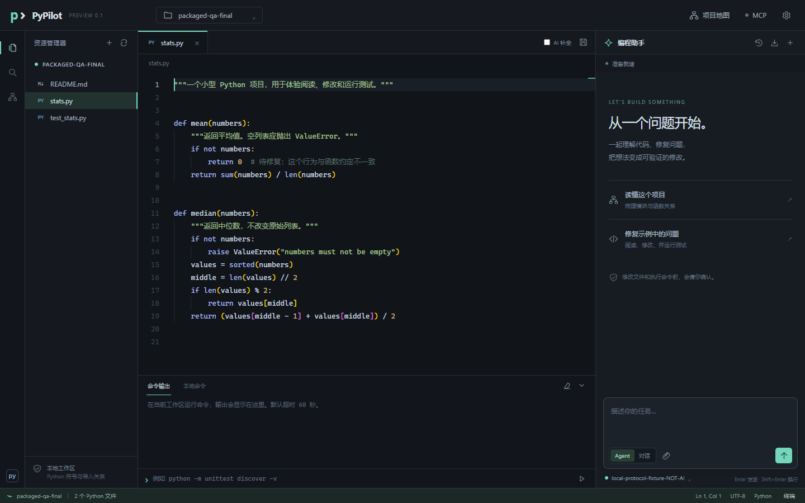
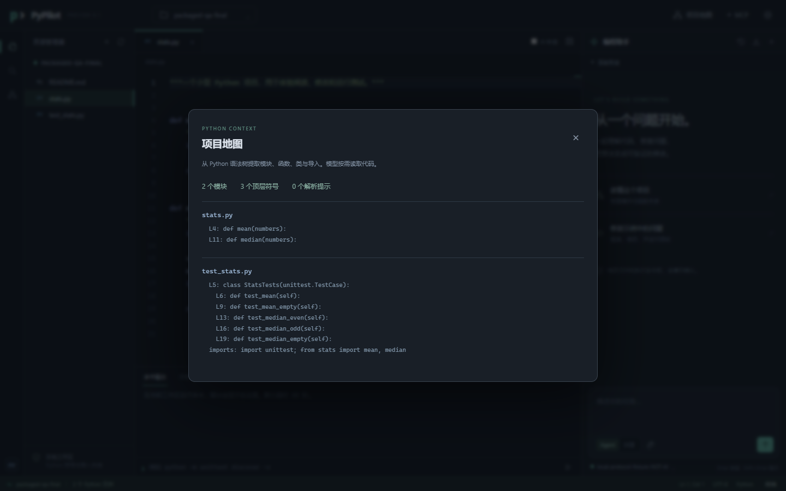
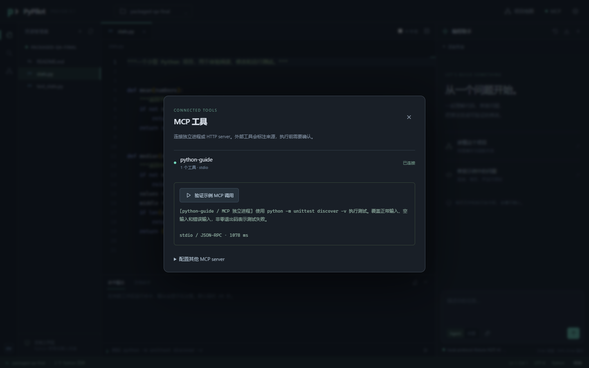

# Lightweight Cursor · PyPilot

面向 Python 项目的轻量桌面 AI 编程工作台。独立 Windows 窗口，左侧文件树、中间 Monaco 编辑器、右侧 AI 对话与 Agent。当前为 **0.1.0 预览版**。

仓库：[hz12345678931/Lightweight-Cursor](https://github.com/hz12345678931/Lightweight-Cursor) · [下载预览版](https://github.com/hz12345678931/Lightweight-Cursor/releases)

## 三步开始

1. 安装 `PyPilot-Setup-0.1.0.exe`，打开 PyPilot。支持 Windows 10/11 x64，需要 Microsoft Edge WebView2 Runtime；已附带 Python，不用另装 Python 或 VS Code。
2. 点击右上角模型设置，填写 **OpenAI 兼容 API 地址、模型名、API Key**，点击“保存并测试连接”。地址通常以 `/v1` 结尾，不包含 `/chat/completions`；选择支持工具调用的模型。
3. 打开你的 Python 项目，或使用自带示例。让 Agent“修复 mean 的空列表行为并运行测试”，审阅差异后接受修改。勾选“AI 补全”可体验行内建议，`Tab` 接受、`Esc` 取消。

首启示例故意保留一个 bug，测试先失败是预期行为。示例会复制到应用数据目录，安装目录中的模板不会被改动。

## 能力

| 功能 | 当前实现 |
| --- | --- |
| 代码编辑 | 本地文件树、多标签、语法高亮、查找、保存、冲突检测 |
| 代码补全 | Python AI 行内补全、防抖与取消、可选独立补全模型 |
| AI 对话 | 流式输出、附加当前文件、选中代码解释、历史记录 |
| 修改代码 | 精确唯一匹配、左右差异预览、确认后原子写入 |
| 项目理解 | Python AST 提取函数、类、导入，按问题排序项目地图 |
| Agent | `read / write / edit / bash` 循环、失败反馈、步骤和时间限制、真实中断 |
| MCP | 内置独立 `python-guide` 进程；可配置 stdio / Streamable HTTP server |
| 交付支持 | 运行记录导出、独立 HTTP/SSE 后端、构建脚本、安装程序 |

目前尚未连接你的真实模型账户。自动化验收使用明确标注的本地协议测试服务；文件操作、命令和 MCP 都实际执行，但固定测试响应不能证明真实模型的编程质量。

本地验证：27 项 Python 测试通过，打包版 9 项界面流程通过，Windows 安装程序退出码为 0，安装后的原生窗口可加载界面。详见 [验证记录](docs/validation.md)。

## 截图

## 开发与作业材料

- [源码运行与打包](docs/build.md)
- [独立后端与 curl 验证](docs/headless.md)
- [老师要求对照和待完成项](docs/requirements.md)
- [设计与实现报告](report.md)
- [本地协议验收记录](trace.md)
- [五分钟演示脚本](docs/demo-script.md)
- [参考项目与边界](docs/references.md)
- [第三方许可](THIRD_PARTY_NOTICES.md)

本版本只分析 Python，不包含复杂插件系统、调试器、完整语言服务器或自动 Git 回滚。文件工具限制在工作区；**批准的 shell 命令与 MCP 进程拥有当前用户权限，不是操作系统沙箱**。模型服务会收到问题、项目符号及按需读取的代码。

用户配置和会话默认在 `%LOCALAPPDATA%\PyPilot`。API Key 使用 Windows DPAPI 加密；若系统凭据加密不可用，则仅保留到本次退出。可通过 `PYPILOT_DATA_DIR` 指定独立数据目录。
