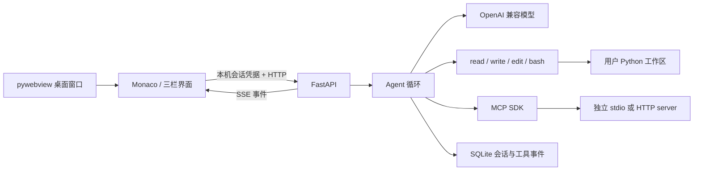

# PyPilot 设计与实现报告（预览版）

## 目标与范围

制作能独立启动的轻量 Python AI 编程工作台。用户在同一窗口浏览文件、编辑代码、与模型对话、审阅修改、运行测试。第一版只理解 Python，不制作全语言语言服务器或复杂插件系统。模型通过用户配置的 OpenAI 兼容接口接入，不在客户端内置私有 API Key。

## 架构

界面使用本地静态资源，不依赖线上 CDN。Python 后端拥有文件操作和模型请求，前端只负责交互、差异展示与确认。桌面主程序和控制台 worker 共享依赖，worker 支持独立后端及 MCP stdio。内嵌 Python 用于在没有开发环境的 Windows 机器执行示例；已有项目 `.venv` 优先。

## Agent 与工具

每轮先提供任务和 Python 项目地图，再消费模型流式响应。工具参数通过 JSON Schema 校验，未知工具不执行。read 自动执行；write、edit、bash、外部 MCP 调用等待界面确认。工具结果原样反馈，模型可依据失败信息重新读取、修正参数、继续验证。

read 对文本提供行号和分页，对图片生成多模态内容块。write 在目标目录创建临时文件，写入并 fsync 后原子替换。edit 必须精确且唯一，连重叠匹配也拒绝。差异生成时记录文件 SHA-256，用户确认时再次检查，防止覆盖编辑期间的外部变化。

bash 工具在 Windows 优先使用 Git Bash，否则使用 UTF-16LE 编码 PowerShell 命令，返回实际 stdout、stderr 和退出码。持续读取输出但每路只保留前 16 KB；超时覆盖进程等待及管道读取。Windows Job Object 在取消、超时或工具结束时清理进程树。

单任务有步数、时间、重复参数和上下文字符上限；模型另有 max_tokens 输出上限。字符数是保守上下文额度，并非服务商精确 token 计费统计。停止通过取消异步任务传播到 HTTP 流、等待中的确认和命令进程；已完成修改保留，不自动撤销。

## Python 理解与补全

Python 标准库 AST 提取函数、类、方法行号和导入语句，按照问题词匹配排序后压缩到模型上下文。没有构建完整调用图，也不执行代码来推断类型。大仓库最多扫描 2,000 个文件，跳过虚拟环境、Git 数据与常见密钥文件。

行内补全从光标前后代码和相关符号生成插入内容，使用约 450 ms 防抖、取消令牌和模型版本检查避免旧建议覆盖新输入。补全是生成式建议，不是类型正确性的保证。

## MCP 与数据

MCP SDK 通过真实 JSON-RPC stdio 会话与 `python-guide` 独立进程通信，调用 `python_tip`。该工具返回静态 Python 实践建议，主要用于验证协议。配置界面也支持其他 stdio / Streamable HTTP server，外部程序启动与工具调用有明确边界和超时。

模型 API Key 使用当前 Windows 用户的 DPAPI 保存；受限系统若无法加密则只存内存。后端仅监听回环地址，API 需要随机本地会话令牌，拒绝跨来源请求。文件路径检查防止文件工具越界；shell/MCP 没有 OS 级沙箱，用户需要审阅命令。发送到模型的项目片段和符号属于外部数据传输，密钥过滤不能替代人工审查。

## 验证与待完成

测试覆盖精确修改、原子写入失败、冲突、分页、图片结构、进程中断、MCP 通信、流式参数拼接与异常响应。UI 验收使用本地固定协议响应，实际执行文件和命令；不把它称为真实 AI 验证。

公开仓库为 [hz12345678931/Lightweight-Cursor](https://github.com/hz12345678931/Lightweight-Cursor)，当前交付版本为 0.1.0 预览版。

仍需用户提供服务地址、模型名并在本机填写 Key，完成真实模型对话、补全、Agent 和视觉能力联调。真实 7 天以上开发记录与 15 次有效提交、v1.0.0 Release、正式演示视频及现场验收属于后续交付，不能用当前预览包声称已经满足。
